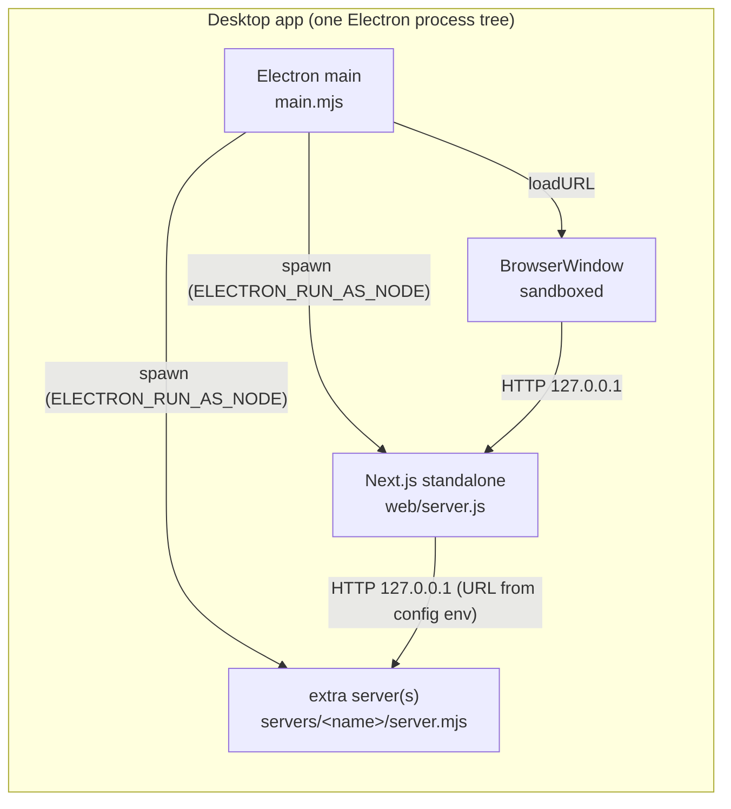
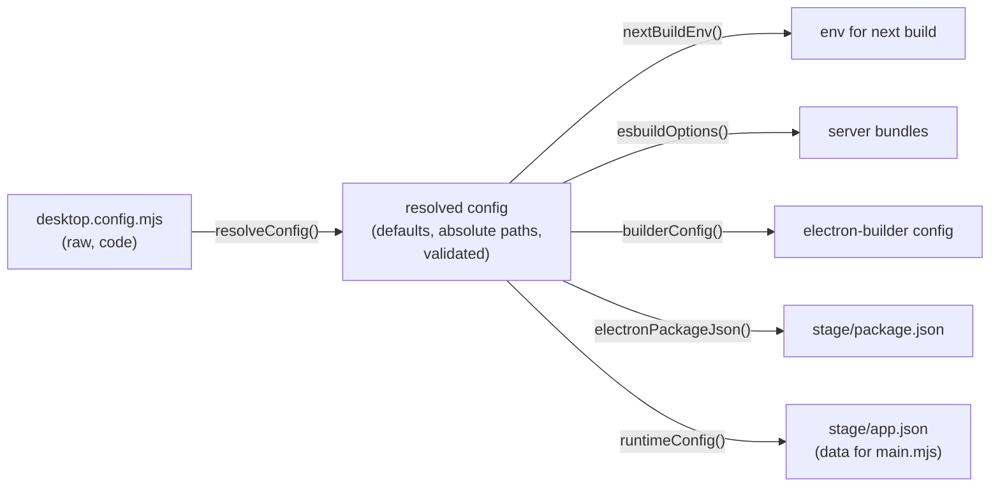
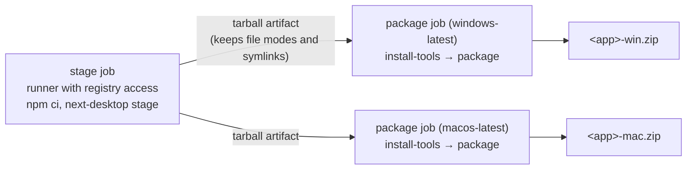

# next-desktop: architecture and implementation

This document explains how next-desktop turns a Next.js app into a Windows or Mac desktop app: its parts, how data moves between them, and why each part works the way it does. For setup and options, see the [README](../README.md).

## 1. The idea

A Next.js app needs a Node server, but a desktop user has no Node. Electron ships its own Node and Chromium, so next-desktop uses Electron for three things:

- **Process launcher.** It runs the Next.js standalone server, plus any extra servers such as a mock backend, on Electron's own Node (`ELECTRON_RUN_AS_NODE=1`).
- **Browser.** One sandboxed window shows the app from `http://127.0.0.1:<port>`.
- **Package format.** electron-builder packs everything into one zip per system.

The Next.js app itself is unchanged: it's the same standalone server you would deploy in Docker. Electron doesn't render or bundle the app. It only starts the servers and points a window at them.



## 2. Two halves: build time and run time

| | Build time | Run time |
| --- | --- | --- |
| Runs on | developer machine or CI, with the project's `node_modules` | the user's machine, inside the packaged app |
| Entry | `bin/next-desktop.mjs` → `src/cli.mjs` | `src/runtime/main.mjs` (Electron main) |
| Can import | the project's `next`, `esbuild`, `electron-builder`, `electron` | Node built-ins and `electron` only |
| Config source | `desktop.config.mjs` (code) | `app.json` (data) |

The run-time files are **copied** into the app as they are. So they import only each other (`main.mjs` → `servers.mjs`, `window.mjs`) and Node built-ins. Everything project-specific reaches them as data in `app.json`. This rule keeps the runtime generic and means the packaged app never runs project config code.

## 3. Module map

```text
packages/next-desktop/
  bin/next-desktop.mjs        CLI entry
  src/
    cli.mjs                   load config file, dispatch command            (I/O)
    config.mjs                resolveConfig, runtimeConfig, stagePaths      (pure)
    packageConfig.mjs         parseCli, hostTarget, builderConfig           (pure)
    stage.mjs                 nextBuildEnv, electronPackageJson,
                              esbuildOptions, sharpSwap, toolsLockfile      (pure)
    build.mjs                 stageApp, packageApp, startStaged,
                              installTools                                  (I/O)
    runtime/
      main.mjs                Electron entry: window, lifecycle, logging    (I/O, Electron)
      servers.mjs             freePort, waitForHttp, fillTemplate,
                              serverEnv, startServers                       (I/O, injectable)
      window.mjs              loadingPage, isAppUrl, opensExternally,
                              isAllowedPermission                           (pure)
  templates/desktop-app.yml   GitHub Actions template
```

The code has a **pure core and a thin shell**:

- **Pure modules** (`config`, `packageConfig`, `stage`, `window`) turn inputs into plain objects such as a resolved config, an electron-builder config, an env or esbuild options. They have no side effects and are fully unit-tested.
- **`servers.mjs`** does I/O, but takes `spawnImpl`, `portImpl` and `waitImpl` (and `waitForHttp` takes `fetchImpl`) as parameters, so tests run it with fakes. It's fully unit-tested too.
- **Shell modules** (`cli`, `build`, `main`) only connect the pure parts to the file system, child processes, esbuild, electron-builder and Electron. They're kept thin and checked by real builds and launches instead of unit tests.

## 4. Configuration flow



`resolveConfig(raw, { root, rootPackage })` does three things:

- **Fills defaults.** `artifactName` (from `name`), `version` and `author` (from `package.json`), `outDir` (`dist-desktop`), `next.distDir` (`.next-desktop`), `readyPath` (`/`), a 1280 x 800 window, the loading text and the error hint.
- **Resolves paths** against the project root: `outDir` and each server's `entry`.
- **Validates**, so mistakes fail fast before the slow Next build:
  - `name` and `appId` are required;
  - `next.distDir` must not be `.next`, so a desktop build can never overwrite, or be mistaken for, the deployable build;
  - server names must match `/^[a-z][\w-]*$/i`, be unique, and not be `app` (that name is reserved for the Next server).

`runtimeConfig(config)` keeps only what the running app needs: the name, window settings, error hint, and for each server its `name`, `label`, folder, entry, `env` and `readyPath`. The Next server is described the same way, as the `app` entry (`dir: 'web'`, `entry: 'server.js'`). Build-only settings such as `next.buildEnv` never reach the user's machine.

## 5. Build pipeline

`next-desktop build` runs `stage`, then `package`. They're separate commands so the two steps can run on different machines (see section 9).

```mermaid
sequenceDiagram
  participant CLI as cli.mjs
  participant B as build.mjs
  participant Next as next build
  participant ES as esbuild
  participant EB as electron-builder
  CLI->>CLI: parseCli, load desktop.config.mjs, resolveConfig
  CLI->>CLI: hostTarget(platform, arch)  (fails early on Linux)
  CLI->>B: stageApp(config)
  B->>B: delete outDir
  B->>Next: next build (env = buildEnv + NEXT_DESKTOP_DIST_DIR)
  Next-->>B: <distDir>/standalone, <distDir>/static
  B->>B: stageWeb: copy standalone, static, public → resources/web; delete .env*
  loop each extra server
    B->>ES: bundle entry → resources/servers/<name>/server.mjs
    B->>B: copy the server's copy[] files beside the bundle
  end
  B->>B: stageElectron: copy runtime/*.mjs, write package.json + app.json → stage/
  CLI->>B: packageApp(config, target)
  B->>EB: build(zip target, builderConfig)
  EB->>EB: pack stage/ → app.asar; copy servers/ as extraResources
  EB->>B: afterPack: copy resources/web → <Resources>/web
  EB-->>B: out/<artifactName>-<version>-win|mac.zip
```

### 5.1 Next.js build

`nextBuildEnv` sets `NEXT_DESKTOP_DIST_DIR`, and the project's `next.config.js` uses it as `distDir`. With `output: 'standalone'`, Next copies only the files the server needs into `<distDir>/standalone`, including a trimmed `node_modules`. `NEXT_PUBLIC_*` values in `next.buildEnv` are written into the client bundle at this step, so each build has fixed values.

`next` is loaded from the project (`createRequire(<root>/package.json)`), not from next-desktop's folder, so the build always uses the project's own Next version. `esbuild`, `electron` and `electron-builder` are loaded the same way.

### 5.2 Staging the web server

`stageWeb` copies three things:

- `standalone/` to `resources/web`;
- `static/` to `web/<distDir>/static`;
- `public/` to `web/public`.

Next's standalone output leaves out `static/` and `public/` by design, which is why they're copied separately. `stageWeb` also deletes every `.env*` file from `web`, because they can hold real endpoints or keys and must never ship. It stops with an error if the build produced no standalone `server.js`.

### 5.3 Bundling extra servers

Each server's `entry` is bundled into one ESM file with esbuild (`platform: node`, `target: node22`). A `createRequire` banner gives the bundle a working `require` for CommonJS dependencies. The bundle needs no `node_modules`, so each server folder stays small.

Data that a server reads at run time, such as fixtures, is listed in its `copy` setting and copied beside the bundle. So the server must find its data relative to its own file (`import.meta.url`), not the working directory.

### 5.4 The Electron stage

`stage/` is a minimal Electron app: the three runtime files, `app.json`, and a `package.json` with `main: 'main.mjs'` and no dependencies. `next-desktop start` runs Electron on this folder directly; in that mode, `main.mjs` finds the servers in `../resources`.

### 5.5 Packaging

`builderConfig` produces the electron-builder config:

| Setting | Why |
| --- | --- |
| `directories.app = stage` | Only the runtime files go into `app.asar`. |
| `extraResources: servers → servers` | The server bundles sit outside the asar as plain files, so the spawned Node can run them. |
| `afterPack` copies `web` | `extraResources` drops `node_modules`, which the Next server needs. `packager.getResourcesDir()` gives the right folder on each system. |
| `npmRebuild: false` | The stage has no dependencies to rebuild. The web server's `node_modules` is copied as built. |
| `electronVersion` | Read from the project's installed `electron`. |
| zip target, `win.artifactName`, `mac.artifactName` | A zip of the app folder; see section 8. |
| `mac.identity: '-'`, `hardenedRuntime: false`, `notarize: false` | An ad-hoc signature; see section 8. |

The packaged layout:

```text
<name>.exe                     (Mac: <name>.app/Contents/MacOS/<name>)
resources/                     (Mac: <name>.app/Contents/Resources/)
  app.asar                     main.mjs, servers.mjs, window.mjs, app.json, package.json
  servers/<name>/server.mjs    one bundle per extra server, plus its copied data
  web/                         Next standalone: server.js, <distDir>/, node_modules/, public/
```

The Next server folder is called `web`, not `app`, because Electron would treat `resources/app` as its own app folder and load it instead of `app.asar`.

## 6. Run time

### 6.1 Start-up sequence

```mermaid
sequenceDiagram
  participant E as Electron (main.mjs)
  participant W as BrowserWindow
  participant S as servers.mjs
  participant X as extra server(s)
  participant N as Next server
  E->>E: requestSingleInstanceLock (else quit)
  E->>E: read app.json; open servers.log; set permission handler
  E->>W: create window, show the loading page
  E->>S: startServers(config, resourcesDir, execPath, env)
  S->>S: pick a free 127.0.0.1 port per server (all different)
  loop each extra server, in config order
    S->>X: spawn execPath server.mjs (ELECTRON_RUN_AS_NODE=1, env filled)
    S->>X: poll readyPath until 2xx (races against exit or error)
    S->>E: log "[next-desktop] <name> ready at <url>"
  end
  S->>N: spawn execPath web/server.js (PORT, HOSTNAME=127.0.0.1, NODE_ENV=production)
  S->>N: poll readyPath until 2xx
  S-->>E: { url, stop }
  E->>W: loadURL(url)
```

### 6.2 `startServers` in detail

- **Ports.** `freePort` listens on `127.0.0.1:0`, reads the port the system assigned, and closes. `pickPorts` repeats this until every server has a different port. Nothing uses a fixed port, so other programs on 3000 or 9090 don't matter.
- **Order.** The extra servers start one at a time in config order, then the Next server. Each waits until the one before it answers on its `readyPath`.
- **Env.** `serverEnv` starts from the user's env without `NODE_OPTIONS`, so a user's `--require` or `--inspect` can't leak into the servers. It adds `ELECTRON_RUN_AS_NODE=1`, then the server's `env` with placeholders filled in. The Next server also gets `NODE_ENV=production`, `NEXT_TELEMETRY_DISABLED=1`, `HOSTNAME=127.0.0.1` and `PORT`.
- **Placeholders.** `fillTemplate` replaces:
  - `{host}` with `127.0.0.1`;
  - `{port}` with the server's own port;
  - `{port:<name>}` with another server's port (`app` is the Next server).

  All ports are picked before any server starts, so any server can refer to any other. An unknown name throws, so a typo fails at start-up with a clear message.
- **Readiness.** `waitForHttp` polls every 250 ms, with a 1 s timeout per request and 60 s overall. Any 2xx answer counts as ready.
- **Failure.** The first child `error` or `exit` rejects a shared `startupFailed` promise, and every readiness wait races against it. A crashed server therefore fails start-up at once instead of after 60 s. On any failure, every started child is killed and the error goes back to `main.mjs`.
- **Cancelling.** `main.mjs` passes an `AbortSignal`. Aborting it kills the children already running at once (synchronously, because the app may be quitting) and stops any further server from starting.
- **Crash after start-up.** If a server exits later, the others are stopped and `onExit(error)` is called. Exits caused by `stop()` itself aren't reported.
- **Output.** Each child's stdout and stderr go to `onOutput(name, text)`, which `main.mjs` writes to `servers.log` as `[<name>] ...`.
- **Result.** `{ url, stop }`: the Next server's URL, and a function that kills every child.

### 6.3 Window and lifecycle

- **Single instance.** A second launch focuses the existing window instead of starting a second set of servers.
- **Loading page.** The window opens at once on a `data:` URL showing the HTML-escaped name and loading text, so the user sees something during the few seconds of start-up.
- **Shutdown.** Closing the window quits the app: `window-all-closed` → `app.quit()` → `will-quit`, which calls `stop()` and aborts start-up, so servers die even if the window closes while they're still starting. Then it closes the log. This applies on a Mac too, because a demo with no window and servers still running would only confuse users.
- **Start-up error.** An error dialog shows the message, the config's `errorHint` and the log path; then the app quits.
- **Crash after start-up.** The same kind of dialog ("<name> stopped") appears, and the app quits; the other servers are already stopped.

### 6.4 Security model

The app runs a web page and full Node servers on the user's machine, so the rules are strict:

| Threat | Control |
| --- | --- |
| Other machines reach the servers | Every server binds to `127.0.0.1` only (`HOSTNAME` for Next, `{host}` for extra servers). |
| Web content gets Node access | `contextIsolation: true`, `nodeIntegration: false`, `sandbox: true`, and no preload script. |
| The app window goes to another site | `will-navigate` cancels navigation to any other origin (`isAppUrl`). An `https://` link opens in the system browser instead. |
| Pop-ups and `target=_blank` | `setWindowOpenHandler` always denies. Only `https://` URLs are opened, in the system browser (`opensExternally`). `file:`, `javascript:` and custom schemes are dropped. |
| Web content asks for camera, notifications and similar | `setPermissionRequestHandler` allows only `clipboard-sanitized-write`. |
| Local secrets ship in the zip | `.env*` files are deleted from the staged web server, and build-only env never goes into `app.json`. |
| The desktop build is deployed by mistake | It uses its own `distDir` (never `.next`) and `outDir`, which the project's normal build and Dockerfile never read. |
| A user's `NODE_OPTIONS` changes the servers | `NODE_OPTIONS` is removed from the servers' env. |

## 7. Logging

All output goes to `<userData>/servers.log`, which is emptied on each launch:

- Windows: `%APPDATA%\<name>`;
- Mac: `~/Library/Application Support/<name>`.

Each line starts with its source: the server name (for example `[mock]` or `[app]`), or `[next-desktop]` for the library's own messages. `[next-desktop] <name> ready at <url>` is a stable line that CI smoke tests can read to find each server's URL.

## 8. Platform differences

Only packaging and the CI smoke test differ by system; the runtime code is the same on both.

| | Windows | Mac |
| --- | --- | --- |
| Target | zip of the app folder, x64 | zip of `<name>.app`, for the build machine's chip (`process.arch`) |
| Why a zip | The simplest unsigned format. Self-extracting exes (NSIS, portable) only make sense once the app is signed. | The simplest unsigned format. |
| Signing | None, so SmartScreen may warn. | Ad hoc (`identity: '-'`), because Apple Silicon only runs signed code. Without the hardened runtime, the ad-hoc app can load the Next server's native modules. Not notarized, so Gatekeeper may block it. |
| Resources folder | `resources/` | `Contents/Resources/` (from `packager.getResourcesDir`) |
| Build machine | Windows | macOS (electron-builder builds Mac apps only on a Mac) |

`hostTarget` picks the target from `process.platform`. On Linux it throws before the slow Next build starts.

### Native modules (sharp)

Next's standalone output includes sharp for image optimization. Its native binaries live in `@img/sharp-<os>-<arch>` and `@img/sharp-libvips-<os>-<arch>`, and npm installs only the ones for the machine running `npm install`.

If you stage and package on the same system, this just works. If the stage was built on another system, `install-tools` fixes it:

1. `toolsLockfile` cuts a small lockfile from the project's `package-lock.json`: `electron`, `electron-builder` and `sharp` (which must match the staged `web/node_modules/sharp` version), plus everything they depend on, found the way Node resolves modules. It keeps each `integrity` hash and drops `resolved`, which may point to the private registry. It refuses a package with no hash, so nothing unchecked gets in.
2. `npm ci` installs that lockfile from the public registry (or `NEXT_DESKTOP_REGISTRY`) into a temporary folder, which then becomes `./node_modules`. npm checks every tarball against its hash, so the runner gets exactly the audited packages. The command refuses to run if `node_modules` already exists, so it can't damage a developer's checkout.
3. `sharpSwap` removes every staged `@img/sharp-*` folder and copies in the ones npm just installed for this system.

## 9. CI design

Private packages, such as an internal component library, often live on a registry that GitHub's hosted Windows and macOS runners can't reach. So `templates/desktop-app.yml` splits the work:



- The package jobs never run the project's `npm ci`. They need only Electron, electron-builder and sharp, which `install-tools` installs at the lockfile versions and hashes.
- The stage travels as a `.tgz`, because `upload-artifact` loses file modes and symlinks, which the Mac app and `node_modules/.bin` need.
- The template leaves the smoke test as a TODO, because it depends on the app. A full smoke test would do this: launch the packaged app, reads the `app ready at` URL from `servers.log`, checks the page, closes the app as a user would, and checks that every server has stopped. On a Mac it also verifies the signature with `codesign`.

## 10. Testing strategy

| Layer | How it's tested |
| --- | --- |
| `config`, `packageConfig`, `stage`, `window` | Unit tests: defaults, validation errors, builder settings, sharp swap, tool versions, URL and permission rules. |
| `servers.mjs` | Unit tests with fake spawn, ports and readiness: start order, distinct ports, env, placeholders, early exit, timeouts, stopping on failure, output forwarding. |
| `cli`, `build`, `main` | Excluded from coverage. Checked by running `next-desktop build` and launching the app, locally and in CI on both systems. |

Every file that's included in coverage is at 100%.

## 11. Extending it

| Need | Where to change |
| --- | --- |
| Another local server (a second mock, a small API) | Add an entry to `servers` in `desktop.config.mjs`. Refer to its port from other servers with `{port:<name>}`. |
| A better readiness check | Point `readyPath` at an endpoint that returns 2xx only when the server is really ready. |
| Code signing (Windows certificate, Apple Developer ID and notarization) | In `builderConfig`, replace the ad-hoc `mac` settings, set `hardenedRuntime: true` with entitlements that allow the native modules, and turn on `notarize`. Add signing to `win`. Supply secrets through electron-builder's `CSC_*` env variables, never in the config. |
| An installer instead of a zip | Change the target in `packageApp` (`createTarget('zip', …)`) to `nsis` or `dmg`. First check that endpoint security allows it. |
| Intel or universal Mac builds | Pass a different `arch` from `hostTarget`, or use a `universal` target. The staged sharp binaries must match. |
| Auto-update | Not supported. It would need signing, a publish target and `electron-updater` in the runtime. |
| More window options (menu, icon) | Extend `config.window`, pass it through `runtimeConfig`, and use it in `createWindow`. Keep `webPreferences` locked down. |
| Its own repository | Move `packages/next-desktop` as it is; it has no imports from the host project. Publish it, then point the host's scripts at the installed `next-desktop` binary. |

When you add a setting, keep the two halves apart: build-time settings stay in the resolved config, and only what `main.mjs` needs goes through `runtimeConfig` into `app.json`.

## 12. Known limits

- **No restart.** If a server crashes, the app shows an error and quits; the user opens it again. The cause is in `servers.log`.
- **One window.** There's no menu and no multi-window support.
- **Same-system builds.** A Windows app is built on Windows and a Mac app on a Mac. The stage can be built anywhere, but `install-tools` and `package` must run on the target system.
- **Size.** Each zip holds Chromium, Node and the Next server's `node_modules`, so expect around 200 MB or more.
- **Unsigned.** Users see a SmartScreen or Gatekeeper warning the first time (section 8).

## 13. Key decisions

| Decision | Alternatives | Reason |
| --- | --- | --- |
| Run the unchanged Next standalone server | Static export, custom Electron protocol handlers | Keeps API routes, middleware and server components, and matches the deployed app. |
| Spawn servers with `ELECTRON_RUN_AS_NODE` | `utilityProcess`, loading servers inside the main process | Plain child processes with their own env and working folder; easy to kill; one log prefix per server; no second Node to ship. |
| Free ports on `127.0.0.1` | Fixed ports | Never clashes with other programs. |
| Runtime config as `app.json` data | Bundling `desktop.config.mjs` into the app | The runtime stays generic and never runs project code, and build-only env stays out of the zip. |
| One package for Windows and Mac | One per system | The runtime is identical; only a few builder settings differ. |
| Zip, unsigned or ad-hoc signed | NSIS, portable, DMG, signed | Needs no certificates, for team-internal use. Signing can be added later (section 11). |
| esbuild for extra servers | Copying their `node_modules` | One small file per server, with no dependency tree to trace. |
